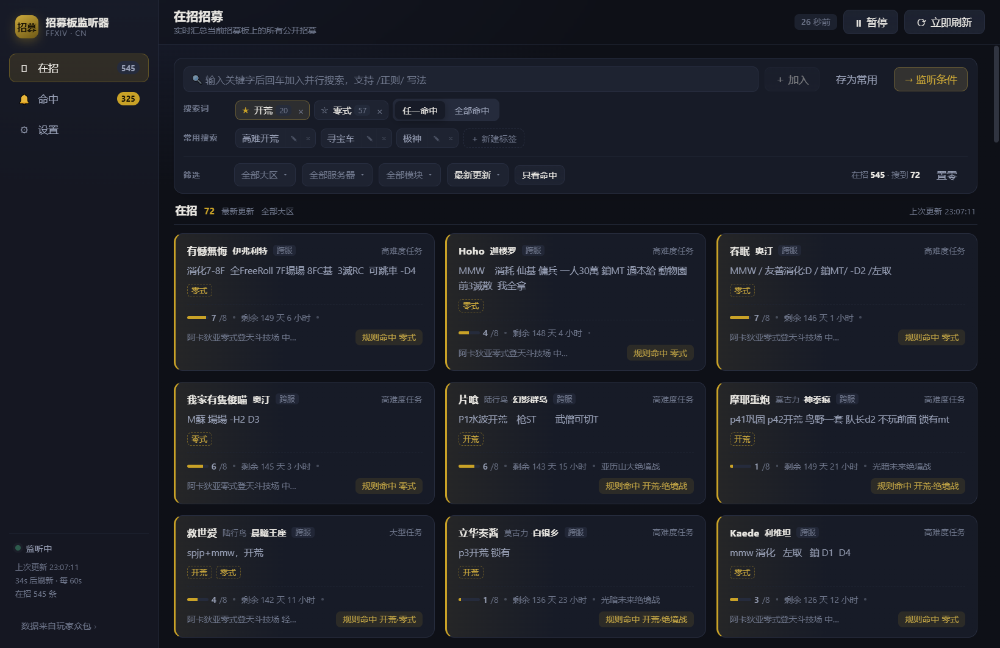
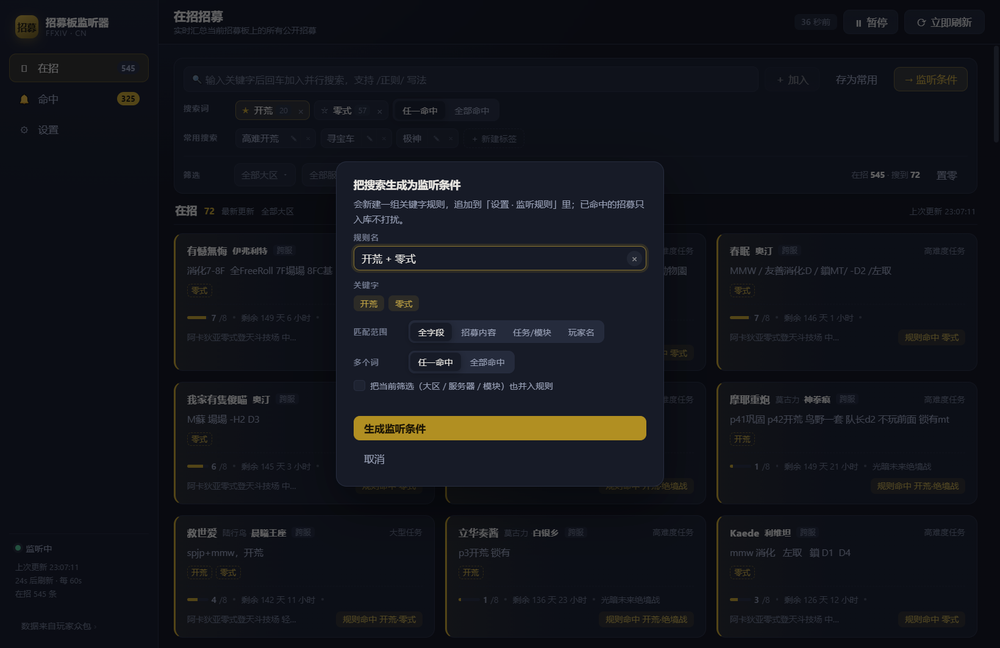
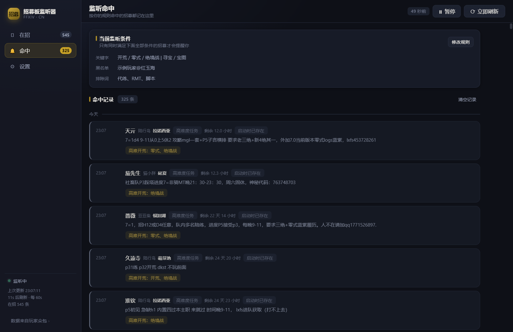
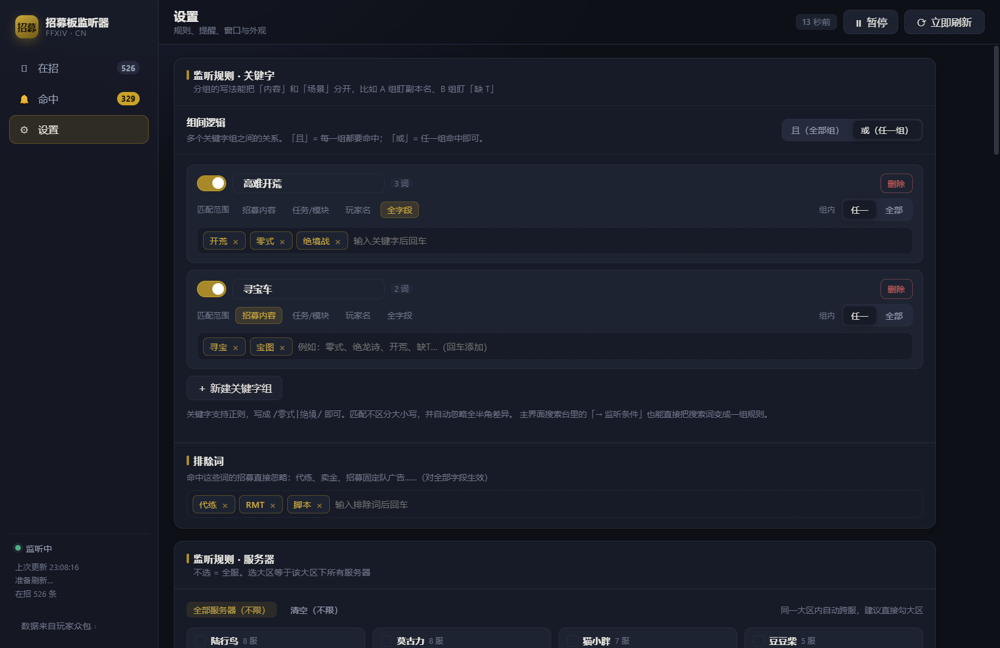
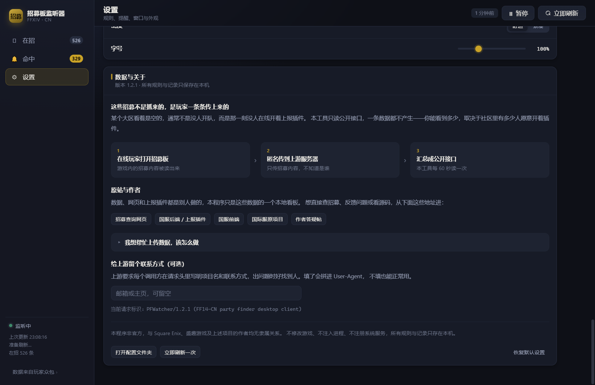

<div align="center">
  
  <h1>招募板监听器</h1>
  <p>FF14 国服招募板的本地监听客户端 · Windows 桌面端</p>

  <p>
    
    
    
    
    
    <a href="../../actions/workflows/build.yml"></a>
  </p>
</div>



## 这是什么

把国服招募板变成一个可以一直开着的本地看板：按你写的条件盯着，命中了弹通知，不用在游戏里反复刷列表。

- **纯本地**。轮询、匹配、提醒全在你的机器上完成，没有自建服务器，不注册系统服务，不写开机启动项。
- **只读公开接口**。不注入游戏进程、不读写游戏文件、不需要登录游戏。
- **可关可留**。点 × 是退出还是缩到托盘，第一次问你，之后记住。

## 功能

**监听规则**

- 多关键字组：组内可以「任一命中」或「全部命中」，组与组之间也可以选任一/全部
- 每个词可选匹配范围：全字段 / 招募内容 / 任务或模块 / 玩家名
- 支持 `/正则/` 写法，自动忽略大小写和全角半角差异
- 排除词：命中直接静音，用来滤掉代练、广告类招募
- 服务器与大区：按客户端登录界面的顺序排列，选大区等于该大区下所有服务器
- 招募模块：按游戏内任务类型的顺序排列（随机任务 / 迷宫挑战 / 讨伐歼灭战 / 大型任务 / 高难度任务 / 寻宝 / 怪物狩猎 / 深层迷宫 …）
- 玩家黑白名单：支持 `名字@服务器`、`名字@大区`、`名字@一区`（全角 ＠ 也认）。角色名只在服务器内唯一，裸名如果撞上多服同名，条目上会标「⚠ N 服同名」
- 人数门槛：最低空位数、只看跨服、忽略快满的车

**搜索台**

- 并行搜索：回车加词，多个词同时生效，每个词旁边显示自己的命中数
- 常驻词：标了 ★ 的词，点「置零」也不会被清掉
- 常用搜索：把一组词（可连同当前筛选）存成标签，下次一键套用，可改名、改词、删除
- 四个下拉：大区 / 服务器 / 模块 / 排序，都带条数
- 「→ 监听条件」：把当前搜索直接变成一条监听规则，不用再去设置页重敲一遍

**提醒与记录**

- 系统通知、自定义提示音、任务栏闪烁，命中数超过阈值才打扰你
- 命中记录单独存一份，带命中理由（哪个词、哪条规则），可以回看

**外观**

- 明暗主题 × 卡片/表格两种布局，强调色、信息密度、字号都能调

## 截图

| 搜索台与在招列表 | 搜索直接生成监听规则 |
|---|---|
|  |  |

| 命中记录 | 监听规则设置 |
|---|---|
|  |  |



## 下载与使用

到 [Releases](../../releases) 下载最新的 `PFWatcher-x.y.z.exe`，双击就能跑。单文件、免安装，不需要 Node、.NET 或浏览器。

第一次启动会先解压到临时目录，等 3~5 秒。因为没有代码签名，Windows SmartScreen 可能拦一下：点「更多信息」→「仍要运行」。

配置文件在 `%APPDATA%\招募板监听器\`，拷走这个目录就等于带走全部规则和记录。

## 数据从哪来

**这一条很重要，请先读。**

招募数据不是官方接口，是玩家自发上报的众包快照：

1. 某个在线玩家在游戏里打开招募板；
2. 他电脑上的 Dalamud 插件把这一瞬的招募内容匿名传上去；
3. 上游汇总成公开接口，本程序定时读一次。

所以某块区域看着是空的，通常不是没人开队，而是那一刻没有装着插件的玩家路过那个招募板。本工具一条数据都不产生——你能看到多少，取决于社区里有多少人愿意开着插件。

上游项目：

| 项目 | 地址 |
|---|---|
| 招募查询网页 | https://xivpf.ff14.xin |
| 国服后端 | https://github.com/LittleNightmare/remote-party-finder |
| 国服前端 | https://github.com/Cindy-Master/remote-party-finder-frontend |
| 国际服原项目 | https://git.anna.lgbt/ascclemens/remote-party-finder |

### 想帮忙上传数据

上报端是 Dalamud 插件（国服叫「卫月」）里的 `RemotePartyFinder`。它在 Dalamud 官方插件库里，叫 **Remote Party Finder Uploader**（默认隐藏，插件列表里要勾「显示隐藏插件」），但官方库那一版默认传到国际服。

要用在国服，有两条路：

- **用现成的**：装官方库那一版 → 插件设置里勾 `Enable Advanced Settings` → 加一条 `https://xivpf.littlenightmare.top/contribute/multiple`，把默认那条停用。
- **用国服分支**：`LittleNightmare/remote-party-finder` 的 `csharp/` 目录，默认地址已经是国服、也跟了国服游戏数据，但没有发布编译好的包，需要 .NET 10 SDK 自己编：

  ```bash
  dotnet build -c Release -p:DalamudLibPath="%APPDATA%\XIVLauncherCN\addon\Hooks\dev"
  ```

  产物里的 `latest.zip` 解到 `%APPDATA%\XIVLauncherCN\installedPlugins\RemotePartyFinder\<版本号>\`。注意版本号这一层目录不能省，少了卫月扫不到。

上传的只有招募板上的公开内容，服务端不知道是谁传的。

## 开发

需要 Node.js 18+。

```bash
npm install
npm run build     # 构建界面到 dist/
npm start         # 启动 Electron，加载 dist/
```

改界面时用热更新，开两个终端：

```bash
npm run dev       # 终端 1：Vite，127.0.0.1:5173
```

```bash
# 终端 2
PF_DEV=1 npm start                          # Git Bash / WSL
$env:PF_DEV='1'; npm start                  # PowerShell
set PF_DEV=1 && npm start                   # CMD
```

主进程（轮询、匹配、托盘、通知）在 `electron/`，渲染进程（React）在 `src/`，两边通过 `preload.js` 的 contextBridge 通信。

## 打包

```bash
npm run dist
```

输出 `release/PFWatcher-<version>.exe`，约 75 MB。体积基本全是 Electron 运行时（Chromium + Node），业务代码不到 1 MB——这是自带浏览器内核的固有成本，删代码省不出来。

首次打包会从 GitHub 抓两份东西：Electron 运行时（约 100 MB）和 winCodeSign 工具。国内网络下这一步经常超时或返回 Bad Gateway，两种绕法：

```bash
# 1) 复用 npm 已经装好的 Electron 运行时
npx electron-builder --win portable -c.electronDist=node_modules/electron/dist

# 2) 还卡在 winCodeSign 的话，跳过签名与元数据写入
npx electron-builder --win portable -c.electronDist=node_modules/electron/dist -c.win.signAndEditExecutable=false
```

第 2 种出来的 exe 是 Electron 默认图标、也没有版本信息，需要自己用 [rcedit](https://github.com/electron/rcedit) 补：

```bash
rcedit release/win-unpacked/招募板监听器.exe --set-icon build/icon.ico --set-file-version 1.2.1.0
```

最省事的是让 GitHub Actions 出包：打 tag 会自动构建并挂到 Release，见 `.github/workflows/build.yml`。

```bash
git tag v1.2.1 && git push --tags
```

## 目录结构

```
electron/              主进程
  main.js              窗口、托盘、轮询循环、IPC、通知
  api.js               招募接口请求（优先 net.fetch，失败退回 Node fetch）
  matcher.js           规则引擎：服务器/模块/玩家/关键字/人数 逐层过滤
  catalog.js           国服服务器表、别名归一、招募模块表
  config.js            配置读写（userData/config.json，原子写入）
  preload.js           contextBridge 暴露的 API
  assets/              图标与提示音
src/                   渲染进程（React）
  App.jsx              外壳：导航、状态订阅、关闭询问、音效
  views/               在招 / 命中 / 设置
  components/          搜索台、列表卡片、详情抽屉、规则编辑器、基础控件
  lib/                 搜索与排序、玩家名解析、格式化、本地持久化
  styles.css           设计令牌与全部样式
build/                 打包用图标
docs/screenshots/      README 截图
```

## 免责声明

本项目是非官方工具，与 Square Enix、盛趣游戏均无关联。FINAL FANTASY XIV 的名称、图像及相关内容的版权归 Square Enix 所有。

招募数据来自第三方社区项目，版权归原项目作者。本程序只读取公开接口，不修改游戏、不注入进程、不向游戏写入任何数据。请自行判断使用风险，并尊重上游项目的使用约定（例如请求头里带项目名和联系方式）。

## 致谢

- [Anna Clemens](https://git.anna.lgbt/ascclemens/remote-party-finder) —— 原作，Remote Party Finder 插件与网站
- [086 / zeroeightysix](https://github.com/zeroeightysix/remote-party-finder) —— 接手上报端维护，提交至 Dalamud 官方插件库
- [LittleNightmare](https://github.com/LittleNightmare/remote-party-finder) —— 国服后端与上报端适配
- [Cindy-Master](https://github.com/Cindy-Master/remote-party-finder-frontend) —— 国服前端
- [xivpf.ff14.xin](https://xivpf.ff14.xin) —— 提供公开接口

以及所有在游戏里开着上报插件、让这个看板有数据可看的玩家。

## License

[MIT](LICENSE) —— 只覆盖本仓库代码。数据与游戏内容的版权见上面的免责声明。
